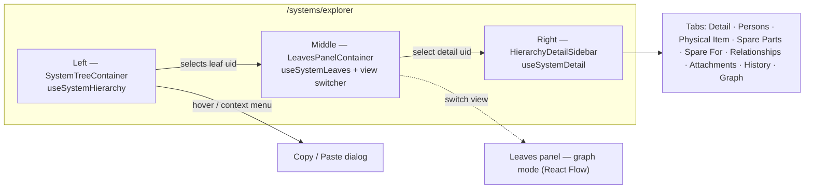

# System Hierarchy (Systems Explorer)

The flagship surface of the systems family — **Systems Explorer** at `/systems/explorer` (menu *Systems → Explorer*; the old `/systems/hierarchy` redirects with its query string) — a three-panel explorer that combines tree navigation, leaves panel (table or graph), and a tabbed detail view for the selected system.

> User-facing companion: [System Hierarchy user guide](../../user-guide/systemHierarchy/README.md).

## Module location

```
src/modules/systemHierarchy/
├── SystemHierarchyExplorer.cont.tsx     — top-level container
├── components/
│   ├── layout/                          — three-panel `HierarchyLayout`
│   ├── tree/                            — left tree (`SystemTree`)
│   ├── leaves/                          — middle panel (`LeavesPanel`, `LeavesTable`)
│   ├── filters/                         — leaves filter sheet
│   ├── sidebar/                         — right Quick-Info / Detail sidebar
│   ├── tabs/                            — Detail tabs, thin wrappers over the shared sections
│   ├── detail/                          — header, tabs container, actions, minimal-spares modal
│   ├── graph/                           — React Flow relationship graph
│   ├── copy/                            — Copy / Paste dialog
│   ├── create/                          — Create Subsystem dialog (right-click → Create System)
│   └── relationships/                   — relationships tab visualisation
├── hooks/
│   ├── queries/                         — tree, leaves, graph, relationships (REST)
│   ├── mutations/                       — copy, delete system, recalculate spares
│   └── useHierarchyNavigation.ts + many graph/leaves hooks
├── store/
│   ├── useHierarchyStore.ts             — tree + graph expansion, copy buffer
│   └── useDetailGraphStore.ts           — detail-graph view preferences
├── types/                               — schemas, constants, graph types
└── utils/                               — tree, graph, filter, colour helpers

src/modules/shared/system/system-detail/ — single-system read model + writes, shared with the Edit System sheet
├── types.ts                             — REST contract (`SystemDetail`, PATCH bodies, spare / property / order shapes)
├── hooks/queries/                       — useSystemDetail, useSystemSpareParts, useSystemSubsystems, usePhysicalItemCatalogueProperties, usePhysicalItemOrders
├── hooks/mutations/                     — useSystemPatch, usePhysicalItemPatch, useGenerateSystemCode, useCreateSubsystem, useDeleteSystemRelationship (+ engine useSystemScopedWrite)
├── hooks/useSystemFieldSave.ts          — inline-field adapter (role gate + void-returning saves)
├── components/                          — inline field sections, breadcrumbs, image panel, spares, subsystems, properties, orders
├── history/                             — SystemHistoryFeed, useSystemHistory, history types + field labels
└── utils/                               — primeSystemDetailCache, refreshAfterSystemWrite, conflict predicates
```

## Layout



The leaves panel toggles between **Tree View** (the default `LeavesTable`) and **Graph View** (`graph/` components using React Flow). The view choice is held in `useHierarchyStore.graphLayoutMode` and persisted.

## Query and mutation surface

Everything is REST; the module has no GraphQL left ([ADR 0002](../../adr/0002-system-edit-soft-lock-and-rest-patch.md)). Single-system reads and all writes come from `shared/system/system-detail` (barrel `@/modules/shared/system/system-detail`).

### Queries

| Hook | Endpoint | Cache key / notes |
|---|---|---|
| `useSystemHierarchy` | `systemsHierarchy` → `GET /systems/hierarchy` | `HIERARCHY_QUERY_KEY`. 5-minute `staleTime`, no refetch on mount. |
| `useSystemLeaves` | `systemLeaves` → `GET /system/{uid}/leaves` | `[LEAVES_QUERY_KEY, { uid, query }]`; `query` carries pagination/search/filter/sorting plus the optional `directOnly` — see [Direct end systems](#direct-end-systems). |
| `useSystemLeavesCount` | `systemLeavesCount` | `[LEAVES_COUNT_QUERY_KEY, { uid }]`, one query **per rendered tree node**. Always counts every descendant leaf. |
| `useSystemDetail` (shared) | `systemDetail` → `GET /system/{uid}` | `[SYSTEM_DETAIL_QUERY_KEY, { uid }]`, 60 s `staleTime`, no retry on 404 (`isNotFound`). Returns `system: SystemDetail \| null` — never a payload of another uid. `isSeeded` is true while only the navigation seed is cached. |
| `useSystemSpareParts` (shared) | `GET /system/{uid}/spare-parts` | `[SYSTEM_SPARE_PARTS_QUERY_KEY, { uid }]` — inbound `spareParts` (with coverage) + outbound `spareFor`. |
| `useSystemSubsystems` (shared) | `GET /system/{uid}/subsystems` | direct children only. |
| `usePhysicalItemCatalogueProperties` (shared) | `GET /physical-item/{uid}/catalogue-properties` | server-resolved groups with `serviceValue` / `isOverridden`. |
| `usePhysicalItemOrders` (shared) | `GET /physical-item/{uid}/orders` | order + service items, newest first. |
| `useSystemHistory` (shared) | `history` → `GET /system/{uid}/history` | `[SYSTEM_HISTORY_QUERY_KEY, { uid }]`; `changes` parsed from the JSON string. |
| `useSystemRelationships` / `useRelationshipGraph` | `systemGraph` | graph nodes carry `itemUsageUid` (row / node icon). |

### Mutations

All single-system writes share one engine, `useSystemScopedWrite`: soft-lock confirmation → body with the cached `lastUpdateTime` token → `queryMutate` → response written into the detail cache (`refreshAfterSystemWrite`) → `toast.promise`.

| Hook | Endpoint | Notes |
|---|---|---|
| `useSystemPatch(uid)` | `PATCH /system/{uid}` | Partial: absent key = unchanged, `null` = clear; codebooks as `{ uid }`, `operators` / `maintainedBy` as full-replace arrays. Returns the fresh `SystemDetail`. |
| `usePhysicalItemPatch(uid)` | `PATCH /system/{uid}/physical-item` | serial, notes, usage, condition. Same token + scope as the system (audit lands on the System node). |
| `useGenerateSystemCode(uid)` | `POST /system/{uid}/system-code` | generate + save in one step. Release = `useSystemPatch` `{ systemCode: null }`. |
| `useCreateSystem()` | `POST /systems` | root "Create System" sheet (`shared/system/system-create`): PATCH field shapes + optional `parentUid`; absent responsible / location / zone inherited. `confirmCreate(parentUid)` runs the soft-lock confirm before the toast. |
| `useCreateSubsystem(parentUid)` | `POST /system/{parentUid}/subsystems` | body `{ name, systemLevel }`; the server inherits responsible / location / zone and validates level rules. Seeds the new detail, then `refreshSystemStructure`. |
| `useDeleteSystemRelationship()` | `DELETE /system/{from}/relationships/{type}/{to}` | only the 8 engineering types (`REMOVABLE_RELATIONSHIP_TYPES`); the server re-splits spare coverage in the same transaction, so there is no client recalc. 404 also refreshes the views. |
| `useSystemCopy` | `PUT /systems/copy` | server orchestrates the recursive copy. |
| `useDeleteSystem` | `DELETE /system/{uid}` | soft + recursive; immediate invalidate, then background `recalculateSpareParts` + second invalidate. UX in `useDeleteSystemAction` — see [Delete System](#delete-system). |

**Concurrency.** Writes to one system run one after another (`scope: { id: 'system-<uid>' }`) and read the token at *execution* time, so a second inline save carries the token returned by the first. A `409 STALE` (someone else wrote in between) invalidates the detail and toasts `systemHierarchy.toast.staleConflict`; `409 DUPLICATE_SYSTEM_CODE` toasts the duplicate-code message.

**What a write refreshes** (`refreshAfterSystemWrite`): the detail entry (from the response), the system's history, leaves and the overview tables (`systems`, `systemCodes`); the tree + graph when `name` / `systemCode` / `systemLevel` / `systemType` changed; `can-edit` after a responsible / team change; spare parts after `minimalSpareParstCount`.

### `primeSystemDetailCache`

Tree and breadcrumb clicks (`selectParent` / `selectLeaf` with a hint) seed a complete-but-empty `SystemDetail` (name, code, level, path) written with `updatedAt: 0`. The entry is stale from birth, so the mounting `useSystemDetail` fetches the real payload on the key change; `SystemDetailView` shows the header from the seed and a body skeleton while `isSeeded`. A 404 wins over the seed (not-found state). Never overwrites an existing entry.

## Stores

### `useHierarchyStore` (persisted)

State carried across page reloads:

| Field | Type | Purpose |
|---|---|---|
| `expandedNodes` | `string[]` | UIDs currently expanded in the tree |
| `graphLayoutMode` | `GraphLayoutMode` | `VERTICAL` / `HORIZONTAL` / `FORCE` for leaves graph |
| `graphExpandedNodes` / `graphExpandedEdges` | arrays | Cached graph state for the relationship view |
| `copiedSystemUid` | `string \| null` | Copy-paste buffer (one system at a time) |

Notable actions: `toggleNode`, `expandNodes`, `collapseAll`, `setCopiedSystemUid`, `addGraphExpanded` (merges into the persisted graph).

### `useDetailGraphStore` (persisted)

Per-system Graph tab preferences:

| Field | Notes |
|---|---|
| `relationshipTypes` | Visible relationship types; `null` means default (all except `HIDDEN_BY_DEFAULT = ['HAS_SUBSYSTEM']`). |
| `layoutMode` | Mirror of `graphLayoutMode` but local to the detail graph. |
| `expandedNodes` / `expandedEdges` | Persistable cache of graph expansion so coming back to the tab restores it. |

Two stores rather than one because the *leaves* graph (middle panel) and the *detail* graph (right tab) have independent UI state and should not collide.

## Tabs

The tabbed detail surface lives under `components/tabs/`:

| Tab | Container | Notes |
|---|---|---|
| Detail | `DetailTab.cont.tsx` | `SystemNameField` + `SystemClassificationFields` (code with generate / release, level, type, location, zone) + `SystemDescriptionField` |
| Persons | `PersonsTab.cont.tsx` | `SystemPeopleFields` — responsible, team, owner (read-only), operators + maintained by as badge lists (full-replace PATCH arrays; hidden for `SUBSYSTEMS_AND_PARTS`) |
| Physical Item | `PhysicalItemTab.cont.tsx` | `PhysicalItemFields` (EUN / part number read-only; serial, usage, condition, notes via `PATCH …/physical-item`) + `CataloguePropertiesSection` — see [Catalogue properties & service overrides](#catalogue-properties--service-overrides). |
| Spare Parts | `SparePartsTab.cont.tsx` | `SpareRelationsSection mode="spareParts"` — rows with coverage + EUN badges, **Use** (`useSpareDialog`) + **Remove** (`SpareRelationshipDeleteButton`) in `SparePartActions`; header shows `available` / `required` coverage. Use tooltip chain: no role → feature flag off → no physical item → enabled. |
| Spare For | `SpareForTab.cont.tsx` | `SpareRelationsSection mode="spareFor"` — outbound spares with remove. Both tabs read `GET /system/{uid}/spare-parts`; visibility comes from `statistics.sparePartsCount` / `sparesForCount`. |
| Relationships | `RelationshipsTab.cont.tsx` | List of all 9 relationship types, edit/delete |
| Attachments | `AttachmentsTab.cont.tsx` | File manager (MinIO-backed) |
| History | `HistoryTab.cont.tsx` | `SystemHistoryFeed` (shared) + type / user filters; renders `codebookList` and `relationship` changes and the *outside responsibility* badge |
| Graph | `GraphTab.cont.tsx` | React Flow detail graph for this system |

## Catalogue properties & service overrides

User-facing companion: [Physical item details](../../user-guide/systemHierarchy/README.md).

`CataloguePropertiesSection` (shared) renders an item's catalogue properties on the **Physical Item tab**, the **Quick-Info sidebar** (`variant="sidebar"`) and the Edit System sheet. The server resolves overrides (`GET /physical-item/{uid}/catalogue-properties`): the latest service item per property wins, `isOverridden` marks a service value that differs from the catalogue one, and service-only properties come with `value: null`. The effective value is `serviceValue ?? value`; `PropertyRow` shows the `was X` marker. The cross-module `useItemPropertiesData` engine stays for the catalogue explorer only.

## Create Subsystem

User-facing companion: [Creating systems](../../user-guide/systemHierarchy/workflows/creating-systems.md).

The right-click context menu on a tree node offers **Create System** alongside Copy / Paste. The orchestrator is `hooks/useCreateSubsystemAction.ts` — gated by `usePermission([ROLE.SYSTEM_EDIT])`, then `confirmSystemEdit` against the **parent** uid (the new `HAS_SUBSYSTEM` edge — [Per-system edit permission](#per-system-edit-permission)), then opens `CreateSubsystemDialog` through `useDynamicModalStore` with a stable id `create-subsystem-${parentUid}`.

Parent → allowed-child rules are a pure lookup table in `utils/systemLevelRules.ts`:

| Parent level | Allowed child levels |
|---|---|
| `SystemDomain` | `[TechnologyUnit]` |
| `TechnologyUnit` | `[TechnologyUnit, KeySystems, Trash]` |
| `KeySystems` | `[KeySystems, SubsystemsAndParts, Trash]` |
| `SubsystemsAndParts` | `[SubsystemsAndParts, Trash]` |
| `Trash` | `[]` — `canCreateUnder(Trash) === false` |

`TreeNode` calls `canCreateUnder(node.systemLevel)` to disable the menu item, and the dialog's *System level* `Select` is filtered by `getAllowedChildSystemLevels(parentLevel)` (preselected + read-only when only one option remains).

The dialog reads the parent via `useSystemDetail(parentUid)` only to **preview** the inherited `responsible` / `location` / `zone`; the request body is just `{ name, systemLevel }` and the server applies the inheritance and the level rules (400 on violation). `useCreateSubsystem` seeds the created `SystemDetail` into the cache, so `selectLeaf(newUid)` renders every field on first paint.

`TreeNode` also takes a `canEdit` prop and a `onCreateSubsystem(parentUid, parentName, parentLevel)` callback. Permission gating is now uniform — Copy, Paste, Create System, and Delete System are **always rendered** and `disabled` based on `canEdit` (plus their per-action rule: `!canPaste` for paste, `!canCreateUnder(level)` for create). The previous "hide handlers when no edit permission" behaviour in `SystemTree.cont` was dropped in favour of always-render-disabled for better discoverability.

## Delete System

User-facing companion: [Deleting systems](../../user-guide/systemHierarchy/workflows/deleting-systems.md).

Right-click **Delete System** is available on all three system surfaces — tree node (`TreeNode`), leaves table row (`LeavesTable`), and graph node (`SystemNode`). All three call a single orchestrator, `hooks/useDeleteSystemAction.ts`, layered on the `useDeleteSystem` mutation. It returns `{ canEdit, handleDeleteSystem, isPending }`:

- **Permission** — `usePermission([ROLE.SYSTEM_EDIT])`. `handleDeleteSystem` also re-checks `!canEdit || isPending` so an in-flight delete can't be re-fired.
- **Confirm** — wraps the mutation in `useWarningModal` with recursive wording (`systemHierarchy.delete.confirm` — "…and all its sub-systems"). When the user is not responsible for the target, `getOutsideResponsibilityNote` appends the soft-lock note to the **same** confirm (no second dialog) and confirming marks the uid as confirmed for the session ([Per-system edit permission](#per-system-edit-permission)).
- **Feedback** — `toast.promise` (loading / success / error). On HTTP **409** the backend returns the blocking physical items as a bare `SystemPhysicalItemInfo[]` (read from `err.response.data`); the toast lists up to `MAX_LISTED_ITEMS = 3` item names with a locale-neutral `(+N)` overflow, and falls back to a generic message when the body is empty/unparseable.
- **Selection reset** — on success, `isOpenOrAncestor(uid)` decides whether to call `clearSelection()` (new `useHierarchyNavigation` action that drops `parent`/`leaf`/`tab` from the URL). It returns true when the deleted uid is the open leaf or selected parent, an **ancestor of the open leaf** (via `useSystemDetail(selectedLeafUid).parentPath` — the leaf can be opened with a stale `parent`), or an **ancestor of the selected parent** (via `findHierarchyPath(nodes, selectedParentUid)`). This stops the detail panel pointing at a node the recursive delete just removed.

Gating convention matches Copy/Paste/Create: tree + table **render the item `disabled`** when `!canEdit`; the graph **omits** it (`useRelationshipGraphContainerState` passes `onDeleteSystem` only when `canEdit`). The graph callback is threaded node-ward through `useRelationshipGraphFlow` → `utils/graphTransformers`, the same path as `onCopySystem`.

`LeavesTable` wraps its content in a Radix `ContextMenu` **only when `onDeleteSystem` is provided** (otherwise the trigger would suppress the native right-click menu with nothing to show). The right-clicked row is captured by a capture-phase reset on the wrapper (clears the target) plus a bubble-phase `onContextMenu` per row (re-sets it) — so right-clicking empty table area leaves the item disabled.

## Per-system edit permission

User-facing companion: [Understanding edit permissions](../../user-guide/systemHierarchy/workflows/edit-permissions.md). Cross-cutting model: [Permissions model → per-system edit](../permissions-model.md#per-system-edit-responsibility). Decision: [ADR 0002](../../adr/0002-system-edit-soft-lock-and-rest-patch.md).

`ROLE.SYSTEM_EDIT` is the hard gate (fields read-only, actions disabled without it). Responsibility for *this* system — direct, via `responsibleTeam`, or via an ancestor — is a **soft lock**: it is never enforced, only confirmed and recorded.

```
GET /system/{uid}/can-edit → { result: boolean, responsibles: User[] }
```

### Surface

The building blocks live in `src/modules/shared/system/edit-permission/` (barrel `index.ts`; i18n `message.systemPermission.*`):

| File | Role |
|---|---|
| `hooks/useSystemCanEdit.ts` | `useSystemCanEdit(uid)` — `queryFetcher('systemCanEdit')`, key `['systemCanEdit', { uid }]`, 30 s `staleTime`; `ensureSystemCanEdit(qc, uid)` for imperative reads. |
| `hooks/useSystemEditPermission.ts` | `{ canEdit, isOutsideResponsibility, responsibles, status, refetch }` — informational only. |
| `utils/confirmSystemEdit.ts` | `confirmSystemEdit(qc, uid, fm)` — resolves `true` when responsible, already confirmed this session, or unverifiable; otherwise opens `confirmWithWarningModal` with the responsibles and remembers a *yes* per exact uid (`useSystemEditConfirmationStore`, not persisted). `getOutsideResponsibilityNote` returns the note for flows with their own confirm. `SystemEditCancelledError` is the rejection of a declined write. |
| `components/SystemEditRestrictionBanner.comp.tsx` | Informational banner: *not responsible* (responsibles in a tooltip) or *couldn't verify — Retry*. |

`confirmWithWarningModal` (`src/store/useWarningModalStore.tsx`) is the promise flavour of the global warning modal — `true` on confirm, `false` on dismiss or when another prompt replaces it.

### Where it runs

- **Every single-system write** — `useSystemScopedWrite` (PATCH system / item, generate code) calls `confirmSystemEdit` first; a decline rejects with `SystemEditCancelledError`, so the inline field reverts and no toast is shown.
- **Create subsystem** — against the parent, when the dialog opens (`useCreateSubsystemAction`) and again in `useCreateSubsystem` (a no-op once confirmed).
- **Delete system** — merged into the delete confirm (see [Delete System](#delete-system)).
- **Not prompted** — creating / deleting engineering relationships, spare assignment, images and attachments (role-gated only).

The API records the same fact as `outsideResponsibility: true` on the `WAS_UPDATED_BY` edge; the History tab badges those entries (`history-outside-responsibility`).

## Edit System sheet

User-facing companion: [Editing a system](../../user-guide/systemHierarchy/workflows/edit-permissions.md).

`src/modules/shared/system/system-edit/` — opened by `useSystemEditSheet()(uid)` (l sheet, id `system-edit-<uid>`) from the systems overview (avatar + row action), control-systems rows, the relationship graph, and the facility layout (`getDeviceInfo=<systemCode>` → `useOpenSystemEditByCode`, which resolves the code through `GET /systems?search=` and opens only an exact match). It replaced the form-based sheet **and** the read-only device info overlay (which now only serves `getOfficeInfo` location links).

A quick edit: one column, top to bottom. Each block is a collapsible `Disclosure` (local `SheetSection`), as in the pre-REST sheet.

| Section | Content | Starts |
|---|---|---|
| Header | `SystemBreadcrumbs`, inline title (`SystemTitleField`), *Open in Systems Explorer* link, *Updated X ago*, restriction banner, images (`SystemImagePanel`, autosave) | — |
| Details (level-coloured) | `SystemClassificationFields` (code + generate / release, level, type, location, zone), `SystemDescriptionField` | open |
| People | `SystemPeopleFields` (responsible, team, owner, operators, maintained by) | open |
| Physical item (amber) | `PhysicalItemFields` | open |
| Catalogue properties · Orders & services | `CataloguePropertiesSection` · `PhysicalItemOrdersSection` (only with a physical item) | collapsed |
| Spare parts (n) · Spare for (n) · Subsystems (n) | only when the count is > 0 | collapsed |
| Activity | `SystemHistoryFeed` | collapsed |

Collapsed sections do not mount their content, so their queries only fire when opened. Open / closed state the user sets is remembered per browser (`store/useSystemEditSectionsStore`, persisted as `system-edit-sections`); untouched sections keep the defaults above.

Every field saves on its own; there is no RHF form, Save button or unsaved-changes guard. The systems overview's list cache is **patched in place** after a write (`utils/patchSystemsTableCaches.ts`) and created systems are inserted into it — never invalidated — because the overview merges lazily expanded subsystems into that cache and a refetch would drop the open tree. Clicking a breadcrumb, spare or subsystem **re-targets the sheet in place** (`SystemEditContainer` keeps the current uid in state) instead of stacking sheets. The explorer tabs render the same sections, so the two surfaces cannot drift.

## Deep links & URL contract

The explorer's URL is its source of truth (`useHierarchyNavigation`): `?parent=<uid>` (tree selection), `?leaf=<uid>` (detail view), `?tab=` (defaults to the last tab the user picked — `useHierarchyStore.lastTab`, persisted, initially `detail`; a tab the system lacks falls back to `detail` without overwriting it), `?view=` (`tree`/`graph`), `?direct=1` ([direct end systems](#direct-end-systems)), plus table `page`/`filter`/`search`. All in-page updates are shallow `router.push`; `updateQuery` accepts `{ replace: true }` for history-neutral updates.

`selectParent` resets **only** `page` when the parent changes. `filter`, `search`, and `direct` deliberately carry over — they describe how the user wants to read any node, not one particular node.

**`getSystemHierarchyDetailPath(uid)`** (`utils/hierarchyLinks.ts`) is the canonical builder for cross-module links into the explorer: `/systems/explorer?leaf=<uid>`. It deliberately omits `parent` — **`useHierarchyDeepLinkResolver`** (`hooks/useHierarchyDeepLinkResolver.ts`, mounted once in `SystemHierarchyExplorer.cont.tsx`) fills it in client-side:

- When `leaf` is set and `parent` is missing, it reads `useSystemDetail(leaf).parentPath`, expands the ancestor nodes (`useHierarchyStore.expandNodes`, merge-only), and `router.replace`s `parent=<immediate parent>` (no history entry — back leaves the page in one step).
- Root systems (empty `parentPath`) resolve to `parent === leaf`, an already-legitimate state (`selectParent` produces it in detail mode).
- Guards: `system.uid === leaf` (rejects `keepPreviousData` leftovers), a per-leaf ref (replace is async; prevents double-fire), reset once `parent` is present so a later leaf-only link to the same uid re-resolves.

Consumers: global search (`getRedirectPath`), systems overview action buttons, order lines, control-systems code tables, move wizard, the `/system/[uid]` / `/system/alias/[alias]` / `/system/item/[itemUid]` redirect pages (see [System item](./system-item.md) — that module is deprecated), and `SystemHistoryFeed`'s system links.

An unknown/deleted `leaf` renders a **not-found state** in `SystemDetailView.cont.tsx` (message + *Back to hierarchy* via `clearSelection`) instead of an endless skeleton.

History/field-change types (`HISTORY_TYPE`, `FieldChangeEntry`, `HistoryResponse`, …) live in `types/history.ts` — moved here from `systemItem`, which re-exports them for back-compat. The module no longer imports anything from `systemItem`.

## Copy / Paste

The copy-paste flow lives in `components/copy/`. Buffer: `useHierarchyStore.copiedSystemUid`. The right-click context menu on a tree node or graph node offers **Copy System** (sets the buffer) and **Paste System** (opens the dialog).

The dialog options table:

| *Copy only children* | *Copy recursively* | Effect |
|---|---|---|
| OFF | OFF | Source system only, no descendants |
| OFF | ON | Source + full subtree |
| ON | OFF | Direct children, source skipped |
| ON | ON | **Default** — direct children with their subtrees, source skipped |

Server-side the copy is a single REST call (`useSystemCopy` → `system/<uid>/copy`); the response triggers `useSystemHierarchy` + `useSystemLeaves` invalidation.

See the user-facing walkthrough → [Copying systems](../../user-guide/systemHierarchy/workflows/copying-systems.md).

## React Flow graph

Two surfaces use React Flow:

- **Leaves panel graph view** — `components/graph/`. Driven by `useLeavesGraphState` and the hierarchy store's `graphLayoutMode`.
- **Detail graph tab** — `components/relationships/` + `useRelationshipGraph*` hooks. Driven by `useDetailGraphStore`.

Both share node/edge types from `types/graph.ts` and colour helpers from `utils/graphColors.ts`. Layout helpers in `utils/graphLayout.ts` compute force-directed and orthogonal positions.

`useRelationshipGraphApiQuery` is the gate between React Flow node selection and TanStack Query — expanding a node fires a `useRelationshipGraph` query for that uid and merges the result into the persisted store via `addExpanded`.

## Cache invalidation for spare flows

`matchesSpareAffectedQuery(uids)` (`src/utils/query/spareInvalidationPredicate.ts`) matches every relationship-graph query plus any query whose key params (second slot) reference one of the uids — `[SYSTEM_DETAIL_QUERY_KEY, { uid }]`, `[SYSTEM_SPARE_PARTS_QUERY_KEY, { uid }]`, and the legacy useGraphQL keys still used by `systemItem`. Used by `useSpareDialog` / the spare-assignment wizard and by `useDeleteSystemRelationship` for `IS_SPARE_FOR`. Coverage is re-split server-side on removal, so one invalidation round suffices.

### `SpareRelationshipDeleteButton`

Lives in the shared spare module: `src/modules/shared/system/use-spare/components/spare-relationship-delete-button.comp.tsx`. Thin wrapper around `useDeleteSystemRelationship` that owns the spare-specific copy (`common.spareAssignment.remove.*` inbound, `common.spareAssignment.spareFor.remove.*` outbound); a 404 shows the *already removed* warning.

## Filters

The leaves filter sheet (`components/filters/`) is a multi-field RHF form persisted via TanStack Query URL state (`?filter[…]=`). Filter values land in `useGraphFilters` which feeds both the table and the graph view.

`utils/graphFilters.ts` reproduces the filter logic client-side for the graph (which receives the *whole* relationship slice from the server, not a filtered one).

## Direct end systems

`GET /system/{uid}/leaves` returns every **end system** below the selected node — `HAS_SUBSYSTEM*1..50` plus `WHERE NOT (sys)-[:HAS_SUBSYSTEM]->(:System{deleted:false})`. The tree, symmetrically, returns only nodes that *have* children (plus parentless roots), so end systems never appear in it.

Between the two there was no way to ask **"what hangs directly off this node"**. A node with three direct end systems and a subtree of two thousand deeper ones drowned those three in the table, and the tree could not show them at all.

The **Direct only** checkbox in `LeavesToolbar` (next to the search input) closes that gap by sending `?directOnly=true`, which narrows the server-side traversal to `*1..1`. The existing end-system predicate is what makes depth 1 mean *direct end systems* rather than *all direct children* — no extra predicate is involved.

The explanation is bound to the checkbox with `aria-describedby` → an `sr-only` span, not left to the tooltip alone: Radix puts its own `aria-describedby` on the tooltip *trigger*, which here is the wrapper `div`, so the control itself would carry no description. The tooltip stays for pointer users.

| Aspect | Behaviour |
|---|---|
| State | `?direct=1`, read as `directOnly` and written by `setDirectOnly` (`useHierarchyNavigation`). Survives reload, deep links, and tree navigation. |
| Page reset | `setDirectOnly` clears `?page` in the same `updateQuery` — the narrowed list is shorter, so a retained page would land past its end. |
| Filters / search / sorting | Unaffected. `useSystemLeaves` merges `directOnly` into the query object `useQueryManager` already builds, so the server applies it *and* everything else. The mode narrows scope; it does not replace filtering. |
| Cache | The flag is part of the query key, so the two modes never serve each other's rows. |
| Tree badge | Unchanged — still the total descendant-leaf count. It describes the node, not the current view, and `useSystemLeavesCount` runs per rendered node, so binding it to the mode would fire one request per node on every toggle. |
| Header count | Rendered as `(N direct)` while the mode is on. The tree badge for the same node still shows the total, so two different numbers sit on screen at once and the header is what accounts for the difference. |
| Pagination | `setDirectOnly` drops `?page`, but `useQueryManager` reads the zustand `paginationState` *first* and that is only cleared by an effect. `LeavesPanel.cont` therefore calls `useResetPaginationOnChange(LEAVES_TABLE_ID)` before navigating, so no render requests a page that does not exist in the narrowed set. |

### Empty state

Two independent things can empty the table — the direct-only scope and the search/filter set — and they can both be true. `LeavesEmptyState.comp.tsx` branches on the pair rather than letting one win:

| `directOnly` | narrowed query | Message | Actions |
|---|---|---|---|
| off | on | *No subsystems found* | Clear filters |
| on | off | *No end systems directly under this system* | Show all levels |
| on | on | *…match the current search and filters* | Show all levels **and** Clear filters |

Letting `directOnly` short-circuit would state something potentially false — there may well be direct end systems, just none matching the filter — and offer an escape that lands the user in a second empty state.

"Narrowed query" counts **search as well as column filters** (`instances[LEAVES_TABLE_ID].search`, not just `storeFilters`), because search narrows the result exactly like a filter does.

**Discoverability** comes from `HierarchyNode.hasLeafChildren`, which the API had always returned and the frontend ignored. `TreeNode` now renders a dot next to the count badge when it is true, carrying `role="img"` + `aria-label` — the tooltip is hover-only, and a marker that exists purely for discoverability must not be invisible to the users least able to compensate. The dot is an indicator only, with no click handler: a small target with different behaviour inside a row that already handles clicks would be hit by accident.

The 6px dot is wrapped in a `p-1 -m-1` trigger and the tooltip gets `sideOffset={8}`. Both are required: the shared `Tooltip` sets `disableHoverableContent`, so Radix renders `TooltipContentImpl` *without* `pointer-events: none` and the content closes the tooltip the moment the pointer reaches it. With the default `sideOffset={0}` the content — and the arrow, nudged further out by `translate-y-[calc(-50%_-_2px)]` — sits on the trigger, and `delayDuration={0}` reopens instantly, so the tooltip flickered. The padding makes the target holdable; the negative margin keeps the row's visual footprint; the offset clears the content off the trigger. `src/components/Tooltip.tsx` gained an optional `sideOffset` for this — omitting it preserves the previous behaviour for every other caller.

### System Path column

`useLeavesColumns` takes `{ parentUid }` and renders only the segment of `parentPath` **below the selected node**, via `utils/relativePath.ts#getVisiblePathSegments`. The prefix up to that node is already in the breadcrumbs above the table, so repeating it in every row spent the column's width on nothing.

| Case | Cell |
|---|---|
| System sits deeper | the segment between the selected node and the system |
| Hangs directly off the selected node | a single badge naming the selected node — constant column width, reads as "right here" |
| Selected node absent from the path | the full path (mismatched data or a stale cache: showing too much beats hiding where the system lives) |
| System has no path at all | empty |

The fallback name is taken from the **row's own `parentPath`**, not from `useSystemDetail`. `getPathBelow` empties only when the selected node is the last entry in the path, so it is always present in the row's data — while `useSystemDetail` carries `placeholderData: keepPreviousData` and would, mid-navigation, hand back the *previous* node's name for every row.

Cell and `accessorFn` both go through `getVisiblePathSegments`, so the sort/filter value cannot drift from the rendered text.

`enableSorting: false`: the server's order-by allowlist (`GetSystemLeavesOrderByClauses`) has no `systemPath` entry, so a sort request on it silently falls back to `ORDER BY name`. A header that reorders by something the column does not show is worse than no header control.

Badges in this column are always the neutral variant — the REST leaves query returns `parentPath` as `{uid, name}` only, with no `systemLevel` to colour by.

The checkbox is never disabled. Gating it on the cached `hasLeafChildren` would lock the control with no explanation whenever another session had added a child, and would couple the leaves panel to tree data; the empty state says the same thing but only after a real query.

Backend contract and the rejected alternatives: [ADR 0001](../../adr/0001-direct-only-param-on-leaves-endpoint.md).

## Tests

- `shared/system/system-detail/hooks/mutations/__tests__/useSystemPatch.spec.tsx` — token in the body, per-system serialization (second write carries the first response's token), no token when the detail was never loaded, declined soft lock writes nothing, `409 STALE` → detail invalidation + stale toast, `409 DUPLICATE_SYSTEM_CODE`, release wording.
- `shared/system/edit-permission/utils/__tests__/confirmSystemEdit.spec.ts` — no prompt when responsible, once per uid per session, exact uid only, decline asks again, never blocks on errors; `src/store/__tests__/useWarningModalStore.spec.ts` — promise confirm / dismiss / replaced prompt.
- `shared/system/system-edit/__tests__/` — sheet layout without Save, conditional sections, in-place navigation, not-found / retry; opener options.
- `shared/system/system-detail/history/__tests__/` — feed rendering of `codebookList`, `relationship` and the outside-responsibility badge; field labels; visuals.
- `hooks/__tests__/useDeleteSystemAction.spec.tsx` — role gate, re-entry guard, merged outside-responsibility note, 409 item list, selection reset; `useCreateSubsystemAction.spec.tsx` — role gate + parent soft lock.
- `components/detail/__tests__/SystemDetailView.spec.tsx` — skeleton / error / not-found (404 wins over a seed) / seeded header + body skeleton.
- `components/{tree,leaves,filters,graph,detail,copy,create,tabs,sidebar}/__tests__/`, `utils/__tests__/` (graph, tree, level rules, predicates, relative path) — unchanged behaviour on the REST shape (`makeSystemDetail` factory in `src/testutils/factories/systemDetail.ts`).

## Deprecated / legacy

- The persisted graph state in `useHierarchyStore` (`graphExpandedNodes`/`graphExpandedEdges`) can drift if the underlying graph data changes — stale nodes appear in subsequent loads. Consider TTL or versioning.
- The Graph tab's relationship-type filter (`useDetailGraphStore.relationshipTypes`) initialises to `null` for "default visible types"; new relationship types added to `RELATIONSHIP_DEFINITIONS` will be visible by default unless added to `HIDDEN_BY_DEFAULT`.
- `/systems/hierarchy` and `PATH.SYSTEMS_HIERARCHY` are kept only as a redirect to `/systems/explorer`.

## Maintenance recommendations

1. **TTL the persisted graph state**. Two `persist`ed stores with arbitrary node arrays can outgrow `localStorage`'s 5 MB quota on large hierarchies. Add a soft cap (e.g. last 200 nodes) or invalidate on schema-version change.
2. **Document the two-graph split** (`useHierarchyStore` vs `useDetailGraphStore`) inline. A single sentence at the top of each store would prevent newcomers from collapsing them.
3. **Test `useSystemCopy`** — none of the existing specs cover the copy dialog combinatorics. The matrix in [Copy / Paste](#copy--paste) is a natural test parameterisation.
4. **Delete `systemItem`** — with the root "Create System" sheet on `POST /systems`, it is the last GraphQL writer of `System` (`roomCard` still calls `updatedByResolver`). Unused exports are marked `@deprecated`; see its `DEPRECATED.md` removal criteria.

## Open questions

- Should the Copy / Paste buffer survive a hard reload? Today it does (persisted) — but the user has no UI indicator that something is buffered.
- The Graph tab's force-layout iteration count is hardcoded in `utils/graphLayout.ts`. Configurable per-system?

---

## Data model reference

> 🔧 *Engineer-only; stripped from the wiki.*
>
> REST contract types: `src/modules/shared/system/system-detail/types.ts` (mirrors the API's `models`). Relationship registry: `src/modules/systemHierarchy/types/graph.ts` (`RELATIONSHIP_DEFINITIONS`). Endpoint keys (`src/utils/getEndpoints.ts`): `systemsHierarchy`, `systemLeaves` / `systemLeavesCount` (`directOnly=true` → `*1..1`), `systemDetail` (GET + PATCH), `systemPhysicalItem`, `systemSpareParts`, `systemSubsystems` (GET + POST create), `systemCodeSave`, `systemRelationshipRemove` (`uid` = start, `path` = type, `itemUid` = end), `physicalItemCatalogueProperties`, `physicalItemOrders`, `systemCanEdit`, `systemGraph`, `systemsCopy`, `system` (`DELETE`, soft + recursive, 409 → `SystemPhysicalItemInfo[]`), `recalculateSpareParts`. `/v1` is already in `BASE_URL`.
>
> Audit: the API writes `WAS_UPDATED_BY {at, action, changes, outsideResponsibility}`; `changes` is a JSON `ChangeEntry[]` (`field`, `type` ∈ `string | number | boolean | date | codebook | codebookList | relationship`, `oldValue`, `newValue`) — FE types in `shared/system/system-detail/history/types.ts`.
>
> `systemSubsystems` feeds the Subsystems section of the Edit System sheet (direct children) and the overview table's lazy row expansion; the explorer's direct-only view uses `directOnly` on leaves instead — see [ADR 0001](../../adr/0001-direct-only-param-on-leaves-endpoint.md) for why the direct-only view did not reuse it.
